# AutoSecOps

AutoSecOps is a full-stack security operations automation platform for alert ingestion, detection engineering, incident response, exposure management, threat hunting, analyst decision support, reporting, audit, and production-style deployment.

This README is the technical guide for the deployable project root. It documents architecture, structure, workflows, APIs, configuration, deployment, quality gates, operations, and extension points.

> License author: **n j bala manikantan**

---

## 1. Platform summary

| Property | Detail |
|---|---|
| Application type | Security operations automation and analysis platform |
| Backend | Django 6.x, Django REST Framework, SimpleJWT |
| Data stores | SQLite for local demonstration, PostgreSQL for production-style deployment |
| Async runtime | Celery with Redis broker and result backend |
| Web serving | Django development server for local use, Gunicorn plus nginx for deployment |
| Machine learning | TF-IDF logistic regression classifier with deterministic rules and SHAP explainability |
| Intelligence | Local synthetic records, STIX import, optional TAXII polling, optional OpenCTI and Wazuh adapters |
| Frontend | Server-rendered Django templates with a responsive CSS design system |
| Security | JWT and session authentication, RBAC, organization scoping, audit logging, CSRF protection |
| Safety | No automatic infrastructure changes; sensitive actions require explicit approval |
| Documentation | README, API guide, architecture guide, operations runbook |

---

## 2. What the platform does

AutoSecOps covers the full SOC lifecycle from ingestion to evidence-backed reporting.

### 2.1 Operational capabilities

| Capability | Description |
|---|---|
| Ingestion | Accepts JSON payloads, JSON files, CSV files, UI submissions, and optional connector data |
| Normalization | Converts source-specific fields into a common alert schema |
| Deduplication | Groups repeated evidence using fingerprint, identity, time window, and indicator overlap |
| Correlation | Links alerts by source IP, user, organization, and shared evidence |
| Classification | Uses deterministic rules plus a TF-IDF logistic regression model |
| Explainability | Stores matched rules, important terms, numeric drivers, confidence, and SHAP status |
| Enrichment | Correlates indicators with local, STIX, TAXII, OpenCTI, and synthetic intelligence |
| Detection engineering | Evaluates single-alert, correlation, and threat-intelligence rules |
| Detection review | Supports review, dismissal, alert creation, incident escalation, and CSV export |
| Detection backtesting | Replays historical records without creating operational side effects |
| Incident response | Tracks incidents, assignment, notes, timeline, status, workflows, and metrics |
| Asset risk | Scores assets from criticality, exposure, vulnerabilities, alerts, detections, and intelligence |
| Attack paths | Builds deterministic paths from exposed assets through weaknesses to impact |
| Threat hunting | Parses structured hunt queries and saves reusable hunts |
| Analyst copilot | Produces grounded shift briefings and answers common triage questions |
| Automation | Runs guarded workflows and records approval decisions for sensitive actions |
| Reporting | Generates executive, incident, and threat-intelligence PDF reports |
| Global search | Searches alerts, incidents, detections, assets, vulnerabilities, indicators, audit logs, and reports |
| System status | Reports database, storage, broker, model, inventory, integration, and deployment health |
| Audit | Records mutations, reviews, decisions, and sensitive operations |

---

## 3. Full project structure

```text
Auto-SecOps/
├── manage.py
├── requirements.txt
├── ruff.toml
├── Dockerfile
├── docker-compose.yml
├── docker-compose.prod.yml
├── gunicorn.conf.py
├── .env.example
├── .gitignore
├── .dockerignore
├── LICENSE
├── README.md
│
├── config/
│   ├── settings.py
│   ├── settings_prod.py
│   ├── urls.py
│   ├── api.py
│   ├── api_urls.py
│   ├── asgi.py
│   ├── wsgi.py
│   ├── celery.py
│   ├── system.py
│   ├── system_api.py
│   ├── system_views.py
│   ├── system_status.py
│   ├── context_processors.py
│   ├── audit_audit.py
│   └── maintenance.py
│
├── accounts/
│   ├── models.py
│   ├── api.py
│   ├── views.py
│   ├── urls.py
│   ├── forms.py
│   ├── services.py
│   ├── admin.py
│   ├── apps.py
│   └── migrations/
│
├── organizations/
│   ├── models.py
│   ├── api.py
│   ├── services.py
│   ├── admin.py
│   ├── apps.py
│   └── migrations/
│
├── alerts/
│   ├── models.py
│   ├── api.py
│   ├── views.py
│   ├── urls.py
│   ├── forms.py
│   ├── services.py
│   ├── tasks.py
│   ├── exports.py
│   ├── admin.py
│   ├── apps.py
│   ├── management/
│   │   └── commands/
│   │       └── ingest_sample.py
│   └── migrations/
│
├── intelligence/
│   ├── models.py
│   ├── api.py
│   ├── views.py
│   ├── urls.py
│   ├── services.py
│   ├── stix.py
│   ├── taxii.py
│   ├── mitre.py
│   ├── admin.py
│   ├── apps.py
│   └── migrations/
│
├── incidents/
│   ├── models.py
│   ├── api.py
│   ├── views.py
│   ├── urls.py
│   ├── services.py
│   ├── workflow.py
│   ├── exports.py
│   ├── admin.py
│   ├── apps.py
│   └── migrations/
│
├── detections/
│   ├── models.py
│   ├── api.py
│   ├── views.py
│   ├── urls.py
│   ├── services.py
│   ├── rules.py
│   ├── backtesting.py
│   ├── tasks.py
│   ├── exports.py
│   ├── admin.py
│   ├── apps.py
│   ├── management/
│   │   └── commands/
│   │       └── seed_detections.py
│   └── migrations/
│
├── assets/
│   ├── models.py
│   ├── api.py
│   ├── views.py
│   ├── urls.py
│   ├── services.py
│   ├── risk.py
│   ├── tasks.py
│   ├── exports.py
│   ├── admin.py
│   ├── apps.py
│   ├── management/
│   │   └── commands/
│   │       └── seed_assets.py
│   └── migrations/
│
├── hunting/
│   ├── models.py
│   ├── api.py
│   ├── views.py
│   ├── urls.py
│   ├── services.py
│   ├── query.py
│   ├── admin.py
│   ├── apps.py
│   └── migrations/
│       └── 0001_initial.py
│
├── riskfabric/
│   ├── api.py
│   ├── views.py
│   ├── urls.py
│   ├── services.py
│   ├── attack_paths.py
│   ├── forecast.py
│   └── apps.py
│
├── copilot/
│   ├── api.py
│   ├── views.py
│   ├── urls.py
│   ├── services.py
│   ├── briefings.py
│   ├── questions.py
│   └── apps.py
│
├── automation/
│   ├── models.py
│   ├── api.py
│   ├── views.py
│   ├── urls.py
│   ├── services.py
│   ├── actions.py
│   ├── engine.py
│   ├── admin.py
│   ├── apps.py
│   ├── management/
│   │   └── commands/
│   │       └── seed_autosecops.py
│   └── migrations/
│
├── reports/
│   ├── models.py
│   ├── api.py
│   ├── views.py
│   ├── urls.py
│   ├── services.py
│   ├── pdf.py
│   ├── admin.py
│   ├── apps.py
│   ├── templates/
│   └── migrations/
│
├── audit/
│   ├── models.py
│   ├── api.py
│   ├── views.py
│   ├── urls.py
│   ├── services.py
│   ├── middleware.py
│   ├── exports.py
│   ├── admin.py
│   ├── apps.py
│   └── migrations/
│
├── dashboard/
│   ├── api.py
│   ├── views.py
│   ├── urls.py
│   ├── metrics.py
│   ├── services.py
│   └── apps.py
│
├── search/
│   ├── api.py
│   ├── views.py
│   ├── urls.py
│   ├── services.py
│   └── apps.py
│
├── integrations/
│   ├── models.py
│   ├── api.py
│   ├── views.py
│   ├── urls.py
│   ├── services.py
│   ├── status.py
│   ├── wazuh.py
│   ├── opencti.py
│   ├── taxii.py
│   ├── tasks.py
│   ├── admin.py
│   ├── apps.py
│   └── migrations/
│
├── mlengine/
│   ├── api.py
│   ├── classifier.py
│   ├── explain.py
│   ├── services.py
│   ├── model_info.py
│   └── apps.py
│
├── templates/
│   ├── base.html
│   ├── registration/
│   ├── accounts/
│   ├── dashboard/
│   ├── alerts/
│   ├── intelligence/
│   ├── incidents/
│   ├── detections/
│   ├── assets/
│   ├── automation/
│   ├── reports/
│   ├── audit/
│   ├── search/
│   ├── hunting/
│   ├── riskfabric/
│   └── copilot/
│
├── static/
│   └── css/
│       └── app.css
│
├── samples/
│   ├── synthetic_alerts.json
│   ├── synthetic_alerts.csv
│   ├── sample_alert.json
│   └── sample_stix_bundle.json
│
├── docs/
│   ├── api.md
│   ├── architecture.md
│   └── runbook.md
│
├── scripts/
│   ├── run_checks.ps1
│   ├── production_check.ps1
│   └── dev_server.ps1
│
├── docker/
│   ├── entrypoint.sh
│   └── nginx/
│       └── autosecops.conf
│
├── tests/
│   └── test_platform.py
│
└── .github/
    └── workflows/
        └── ci.yml
```

---

## 4. Technology stack

| Layer | Technology | Use |
|---|---|---|
| Language | Python 3.12 | Application runtime |
| Web framework | Django | ORM, templates, auth, admin, management commands |
| API | Django REST Framework | REST endpoints, serializers, permissions |
| Authentication | SimpleJWT and Django sessions | API tokens and browser access |
| Database | SQLite and PostgreSQL | Local demo and production-style deployment |
| Cache and broker | Redis | Celery broker and result backend |
| Background jobs | Celery | Ingestion, detection, enrichment, asset risk, maintenance |
| ML | scikit-learn | TF-IDF and logistic regression classifier |
| Explainability | SHAP | Model decision explanations where available |
| Intelligence | stix2 and requests | STIX parsing and TAXII polling |
| PDF | ReportLab | Incident, executive, and intelligence reports |
| Web server | Gunicorn | Production WSGI serving |
| Reverse proxy | nginx | Static files, proxying, TLS termination point |
| Static files | WhiteNoise | Static serving without external storage |
| Quality | Ruff | Formatting and linting |
| CI | GitHub Actions | Automated checks |

---

## 5. Architecture

### 5.1 System context

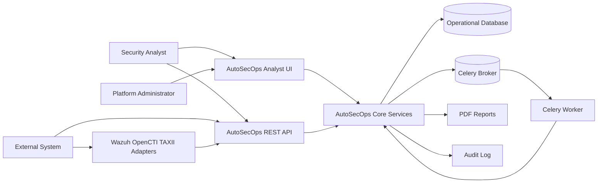

### 5.2 Container architecture

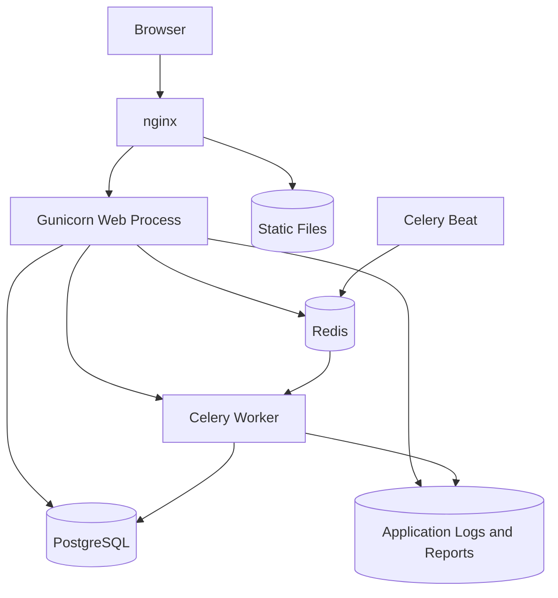

### 5.3 Component architecture

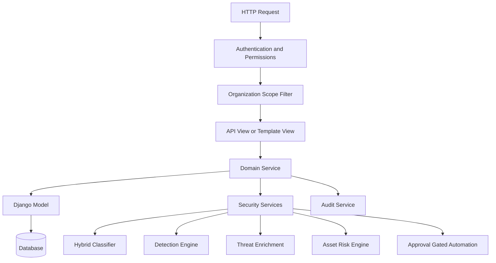

---

## 6. Domain model

| Model | App | Purpose |
|---|---|---|
| `User` | `accounts` | Analyst identity and role |
| `Organization` | `organizations` | Tenant boundary for all operational records |
| `AlertSource` | `alerts` | Source configuration and connector identity |
| `SecurityAlert` | `alerts` | Normalized alert with severity, status, evidence, and classification |
| `AlertClassification` | `alerts` | Category, confidence, explanation, and model metadata |
| `ThreatIndicator` | `intelligence` | IP, domain, hash, URL, or user indicator |
| `ThreatIntelligenceRecord` | `intelligence` | STIX-derived or local intelligence record |
| `SecurityIncident` | `incidents` | Incident lifecycle and response record |
| `InvestigationNote` | `incidents` | Analyst note attached to an incident |
| `IncidentAssignment` | `incidents` | Assignment history |
| `DetectionRule` | `detections` | Deterministic detection logic |
| `DetectionHit` | `detections` | Deduplicated detection finding |
| `Asset` | `assets` | Managed host, service, application, or cloud resource |
| `Vulnerability` | `assets` | Weakness attached to an asset |
| `AssetRiskAssessment` | `assets` | Weighted risk score and contributing evidence |
| `SavedHunt` | `hunting` | Reusable structured hunt query |
| `AutomationWorkflow` | `automation` | Workflow definition |
| `WorkflowExecution` | `automation` | Workflow run result |
| `ApprovalRequest` | `automation` | Human approval record for sensitive actions |
| `Report` | `reports` | Generated report metadata and artifact |
| `AuditLog` | `audit` | Actor, action, object, timestamp, and context |

### 6.1 Entity relationship overview

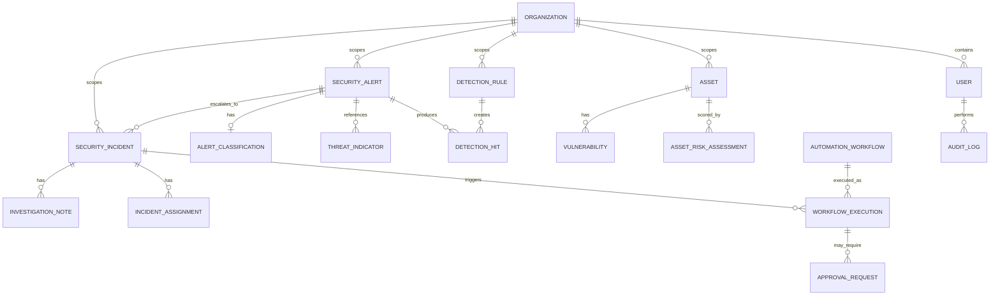

---

## 7. Alert lifecycle

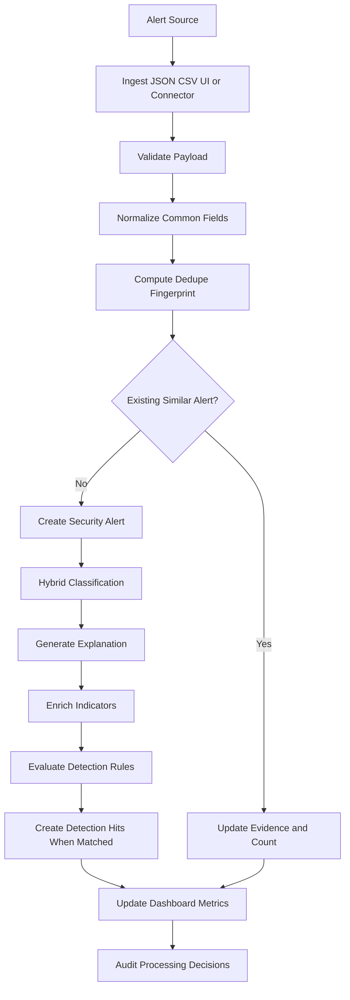

### 7.1 Normalized alert fields

| Field | Meaning |
|---|---|
| `external_id` | Source-native identifier |
| `title` | Short alert title |
| `description` | Raw or summarized evidence |
| `severity` | `LOW`, `MEDIUM`, `HIGH`, or `CRITICAL` |
| `status` | `NEW`, `IN_PROGRESS`, `REVIEWED`, `ESCALATED`, `CLOSED`, or `FALSE_POSITIVE` |
| `source_ip` | Source address evidence |
| `destination_ip` | Destination address evidence |
| `user` | Identity evidence |
| `asset` | Affected asset name or identifier |
| `event_time` | Original event timestamp |
| `raw_payload` | Original event body |
| `fingerprint` | Deduplication identity |

### 7.2 Classification outputs

| Output | Description |
|---|---|
| `category` | Predicted alert category |
| `risk_score` | Numeric risk score |
| `confidence` | Model or rule confidence |
| `matched_rules` | Deterministic rules that fired |
| `top_terms` | Terms contributing to model prediction |
| `numeric_drivers` | Numeric features contributing to risk |
| `shap_status` | Availability state for SHAP explanation |

---

## 8. Threat intelligence and enrichment workflow

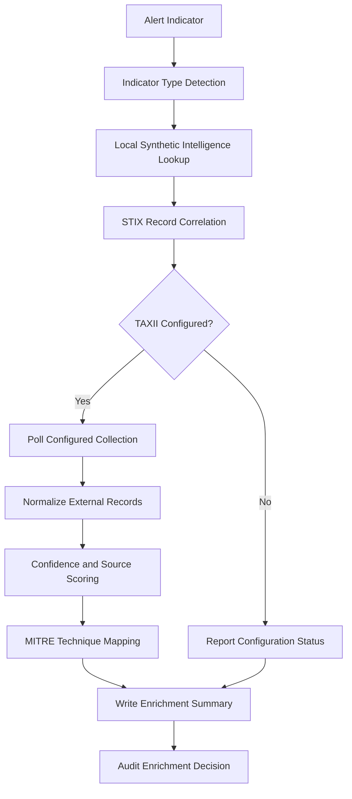

### 8.1 Intelligence sources

| Source | Mode | Failure behavior |
|---|---|---|
| Local synthetic records | Always available in demo mode | Returns local evidence |
| STIX bundle import | File or JSON upload | Validates and reports parse errors |
| TAXII collection | Optional polling with HTTP requests | Reports configuration or connection status |
| OpenCTI | Optional connector | Reports unavailable status |
| Wazuh | Optional connector | Reports unavailable status |
| MITRE ATT&CK mapping | Deterministic technique and tactic map | Falls back to unmapped status |

---

## 9. Detection engineering workflow

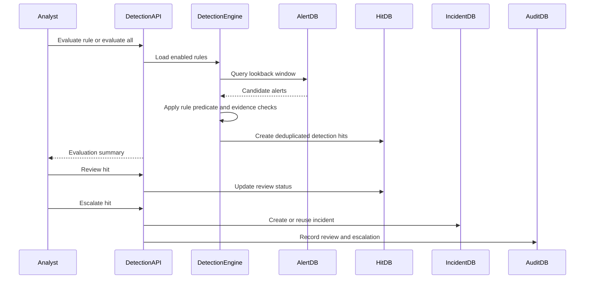

### 9.1 Detection rule types

| Rule type | Logic |
|---|---|
| `SINGLE_ALERT` | Matches one alert by severity, category, title, source IP, user, or description terms |
| `CORRELATION` | Matches grouped alerts sharing identity, source, user, or time window |
| `THREAT_INTEL` | Matches alerts whose indicators appear in intelligence records |

### 9.2 Detection hit actions

| Action | Effect |
|---|---|
| Review | Marks the finding as reviewed with analyst note |
| Dismiss | Marks the finding as false positive or accepted risk |
| To alert | Creates a linked normalized alert |
| Escalate | Creates or reuses an incident |
| Export | Produces CSV evidence |
| Backtest | Simulates historical coverage with no side effects |

### 9.3 Backtest safety

| Behavior | Guarantee |
|---|---|
| Historical replay | Reads existing alerts and intelligence only |
| No new hits | Backtest results are not persisted as detection hits |
| No new alerts | Backtest does not create alert records |
| No new incidents | Backtest does not create incident records |
| No workflow execution | Backtest does not run automation |
| No audit mutations | Backtest requests remain read-only |

---

## 10. Incident response workflow

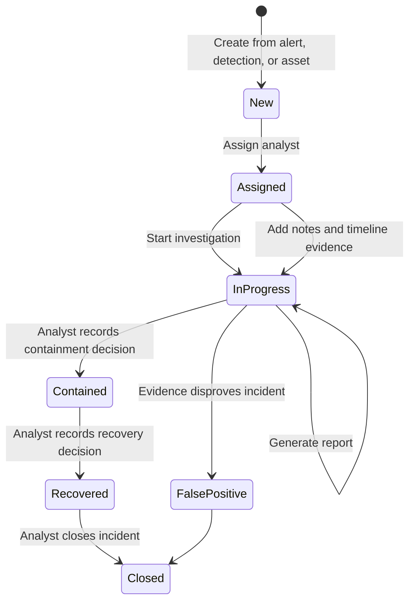

### 10.1 Incident evidence model

| Evidence | Source |
|---|---|
| Alert evidence | Normalized alert fields and raw payload |
| Detection evidence | Rule, matched terms, and hit fingerprint |
| Intelligence evidence | Indicator records and confidence |
| Asset evidence | Asset criticality, exposure, vulnerabilities, and risk |
| Analyst evidence | Notes, timeline entries, assignment, and status decisions |
| Workflow evidence | Executions and approval decisions |
| Report evidence | Generated PDF metadata |

---

## 11. Asset risk workflow

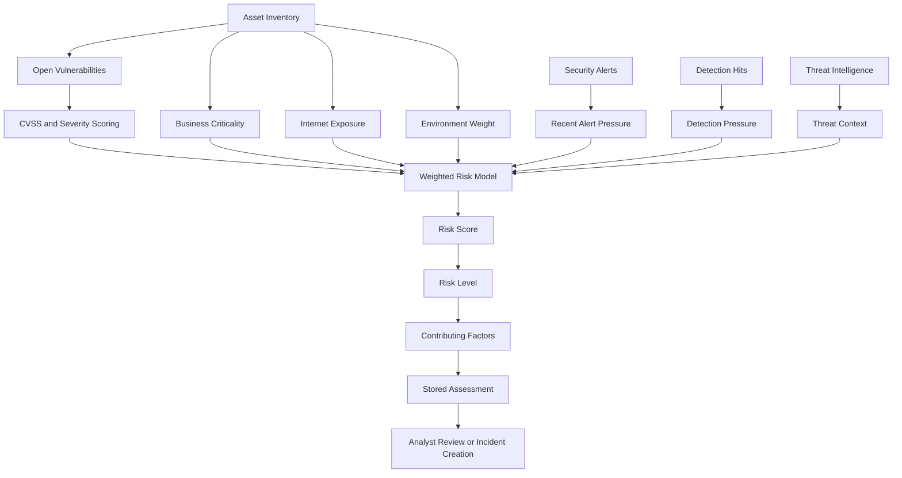

### 11.1 Risk inputs

| Input | Example |
|---|---|
| Criticality | `CRITICAL`, `HIGH`, `MEDIUM`, `LOW` |
| Environment | `PRODUCTION`, `STAGING`, `DEVELOPMENT` |
| Internet exposure | Public-facing service or internal-only system |
| Vulnerability severity | `CRITICAL`, `HIGH`, `MEDIUM`, `LOW` |
| CVSS | Base score from vulnerability record |
| Alert pressure | Recent high-severity alerts affecting the asset |
| Detection pressure | Recent detection hits referencing the asset or user |
| Threat context | Intelligence confidence and indicator severity |
| Patch state | Open versus remediated vulnerabilities |

### 11.2 Risk outputs

| Output | Meaning |
|---|---|
| `latest_risk_score` | Numeric risk score for the newest assessment |
| `latest_risk_level` | Human-readable risk band |
| `open_vulnerabilities` | Count of unresolved weaknesses |
| `factors` | Weighted contribution details |
| `evidence` | Alert, hit, vulnerability, and intelligence references |
| `recommendation` | Analyst-facing next step |

---

## 12. Risk Fabric: attack paths and forecast

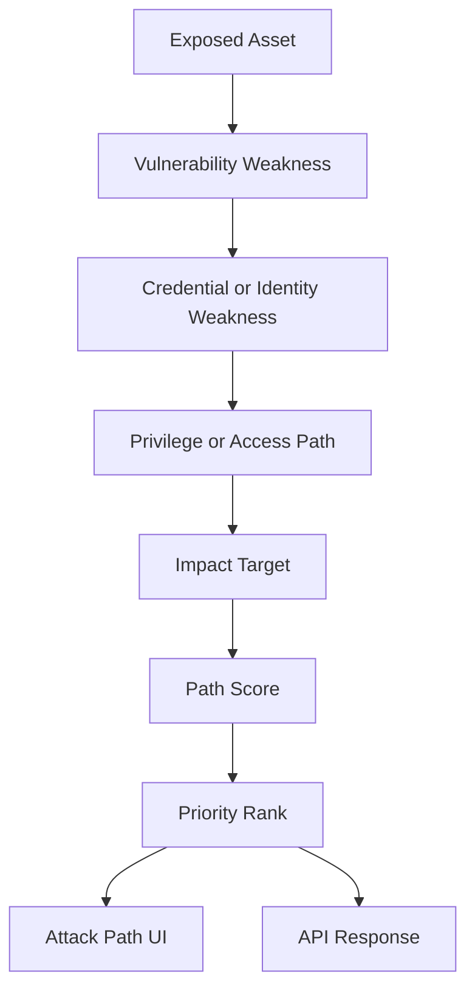

### 12.1 Attack path scoring dimensions

| Dimension | Description |
|---|---|
| Exposure | Whether the asset is internet-facing or reachable from untrusted networks |
| Vulnerability | Severity, CVSS, and exploitability of open weaknesses |
| Identity | Users or credentials associated with the asset |
| Detection pressure | Relevant detection hits and alert volume |
| Threat context | Intelligence matches and confidence |
| Impact | Criticality and environment of the target asset |
| Recommendations | Analyst actions, never automated infrastructure changes |

### 12.2 Forecast dimensions

| Field | Description |
|---|---|
| `direction` | `RISING`, `FALLING`, or `STABLE` |
| `confidence` | Deterministic confidence label |
| `drivers` | Metrics that explain the direction |
| `horizon_days` | Requested forecast window |
| `current_score` | Current risk aggregate |
| `projected_score` | Projected aggregate for the window |

---

## 13. Threat hunting workflow

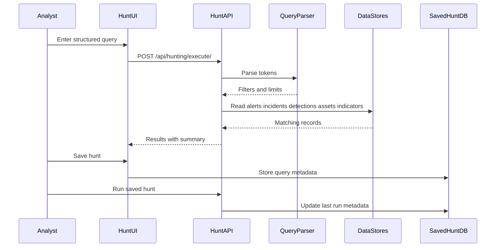

### 13.1 Supported hunt tokens

| Token | Purpose | Example |
|---|---|---|
| `severity` | Filter alert, hit, or vulnerability severity | `severity:HIGH` |
| `type` | Select record group | `type:alert` |
| `ip` | Match source or destination IP fragment | `ip:203.0.113` |
| `user` | Match user identity | `user:alice` |
| `asset` | Match asset name or hostname | `asset:web-01` |
| `status` | Match workflow status | `status:NEW` |
| `q` | Free-text term | `q:brute` |
| `limit` | Result cap | `limit:50` |

### 13.2 Saved hunt fields

| Field | Description |
|---|---|
| `name` | Analyst-friendly title |
| `query` | Structured hunt query |
| `description` | Why the hunt is useful |
| `tags` | Classification labels |
| `created_by` | Analyst owner |
| `organization` | Tenant scope |
| `last_run_at` | Last execution timestamp |

---

## 14. Analyst Copilot workflow

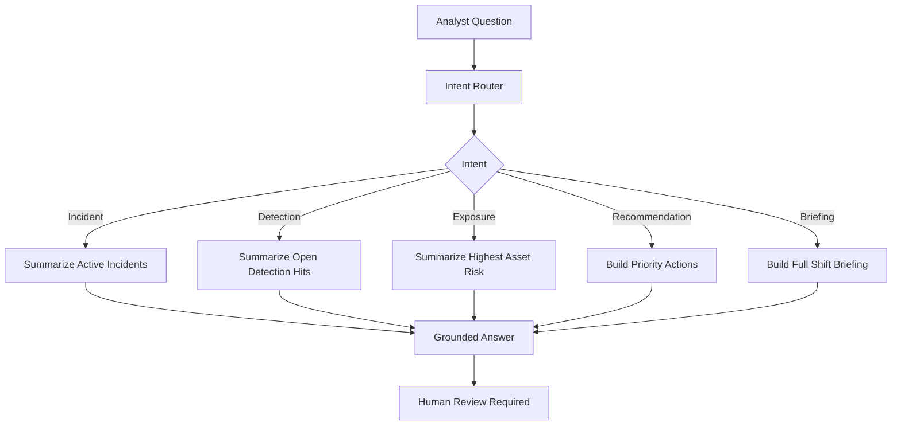

### 14.1 Copilot intents

| Intent | Example question | Grounded source |
|---|---|---|
| Incident | `What incidents need attention?` | Security incidents and assignments |
| Detection | `Which detections are open?` | Detection hits and rules |
| Exposure | `What assets are most at risk?` | Latest asset risk assessments |
| Recommendation | `What should we prioritize?` | Incidents, detections, and risk |
| Briefing | `Give me a shift briefing` | All live operational metrics |

### 14.2 Copilot safety

| Rule | Guarantee |
|---|---|
| Deterministic | Answers are generated from current database evidence |
| No autonomous action | Recommendations require analyst review |
| No infrastructure calls | Copilot never contacts production systems |
| Organization scoped | Answers include only tenant-visible records |
| Auditable | Request context can be traced through normal request auditing |

---

## 15. Automation and approval workflow

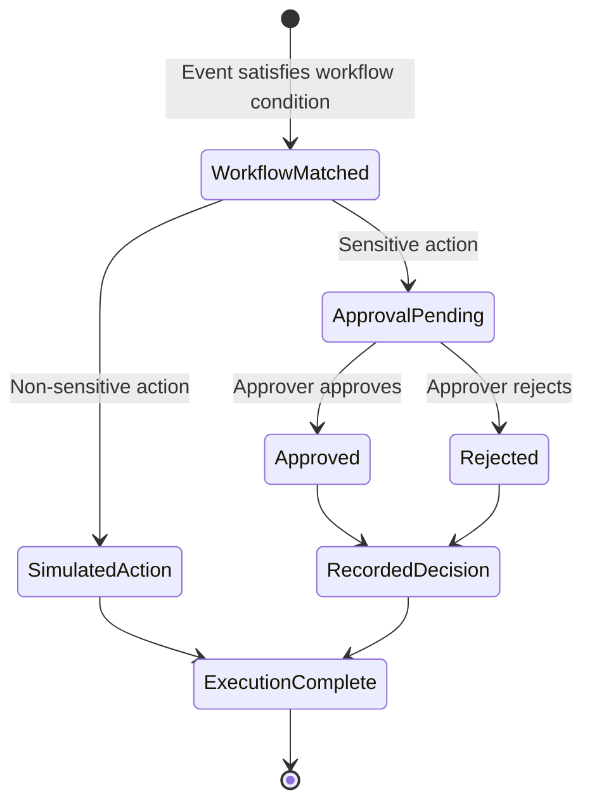

### 15.1 Safety rules

| Action type | Behavior |
|---|---|
| Record note | Allowed after workflow match |
| Create alert | Allowed when explicitly modeled |
| Create incident | Allowed when explicitly modeled |
| Assign owner | Allowed when explicitly modeled |
| Block IP | Not performed automatically |
| Disable account | Not performed automatically |
| Isolate host | Not performed automatically |
| Revoke sessions | Not performed automatically |
| Delete data | Not performed automatically |
| Modify infrastructure | Not performed automatically |

### 15.2 Approval record

| Field | Description |
|---|---|
| Workflow | Workflow that requested the action |
| Execution | Execution instance |
| Requested action | Human-readable action description |
| Requested by | User or system actor |
| Decision | Approved or rejected |
| Approver | Authorized human |
| Note | Approval rationale |
| Timestamp | Decision time |

---

## 16. Reports and audit workflow

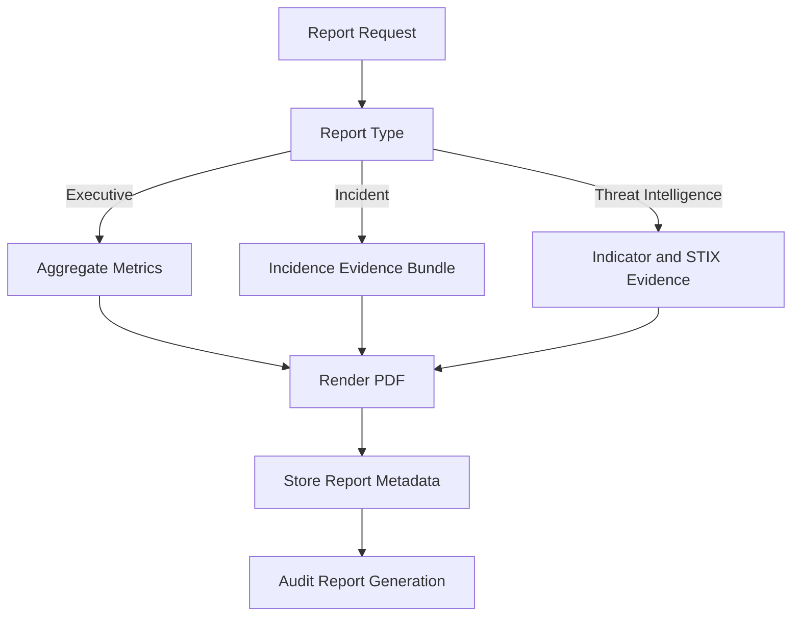

### 16.1 Report types

| Type | Contents |
|---|---|
| `EXECUTIVE` | Open alerts, incidents, risk posture, detection coverage, and trends |
| `INCIDENT` | Incident timeline, notes, alerts, evidence, and response status |
| `THREAT_INTELLIGENCE` | Indicators, malicious records, sources, confidence, and MITRE mapping |

### 16.2 Audit events

| Event category | Examples |
|---|---|
| Authentication | Login, token use, registration |
| Alerts | Ingestion, classification, review, status change, export |
| Incidents | Creation, assignment, note, status change, workflow execution |
| Detections | Rule toggle, evaluation, hit review, escalation, export |
| Assets | Assessment, reassessment, vulnerability status, incident creation |
| Automation | Workflow execution, approval request, approval decision |
| Reports | Generation and download |
| Advanced | Search, hunt execution, saved hunt changes, risk fabric, copilot, backtest |

---

## 17. API reference

Base URL: `/api/`

### 17.1 Authentication and identity

| Method | Endpoint | Purpose |
|---|---|---|
| POST | `/api/auth/register/` | Register a user |
| POST | `/api/auth/token/` | Obtain JWT access and refresh tokens |
| POST | `/api/auth/token/refresh/` | Refresh JWT access token |
| GET | `/api/auth/me/` | Get current user profile |
| GET/POST | `/api/users/` | List or create users |
| GET/PUT/PATCH/DELETE | `/api/users/{id}/` | Manage a user |

### 17.2 Core operations

| Method | Endpoint | Purpose |
|---|---|---|
| GET | `/api/dashboard/metrics/` | Dashboard KPI payload |
| GET | `/api/integrations/status/` | Connector availability and configuration status |
| GET | `/api/system/status/` | Full platform health and inventory |
| GET | `/api/ml/model-info/` | Classifier metadata and SHAP status |
| GET | `/api/search/?q=...` | Unified global search |

### 17.3 Alerts

| Method | Endpoint | Purpose |
|---|---|---|
| GET/POST | `/api/alerts/` | List or create alerts |
| GET/PUT/PATCH/DELETE | `/api/alerts/{id}/` | Manage an alert |
| POST | `/api/alerts/ingest/` | Ingest JSON, file, or CSV |
| GET | `/api/alerts/export-csv/` | Export filtered alerts |
| POST | `/api/alerts/{id}/process-async/` | Queue asynchronous processing |

### 17.4 Intelligence

| Method | Endpoint | Purpose |
|---|---|---|
| GET/POST | `/api/threat-indicators/` | List or create indicators |
| GET/PUT/PATCH/DELETE | `/api/threat-indicators/{id}/` | Manage an indicator |
| GET/POST | `/api/threat-intelligence/` | List or create intelligence records |
| POST | `/api/threat-intelligence/import-stix/` | Import STIX bundle |
| POST | `/api/threat-intelligence/taxii/` | Poll configured TAXII collection |

### 17.5 Incidents

| Method | Endpoint | Purpose |
|---|---|---|
| GET/POST | `/api/incidents/` | List or create incidents |
| GET/PUT/PATCH/DELETE | `/api/incidents/{id}/` | Manage an incident |
| POST | `/api/incidents/from-alert/` | Create incident from alert |
| POST | `/api/incidents/{id}/assign/` | Assign incident |
| POST | `/api/incidents/{id}/change-status/` | Change incident status |
| POST | `/api/incidents/{id}/run-workflows/` | Evaluate workflows |

### 17.6 Detections

| Method | Endpoint | Purpose |
|---|---|---|
| GET/POST | `/api/detection-rules/` | List or create rules |
| POST | `/api/detection-rules/{id}/evaluate/` | Evaluate one rule |
| POST | `/api/detection-rules/evaluate-all/` | Evaluate all enabled rules |
| POST | `/api/detection-rules/{id}/toggle/` | Enable or disable a rule |
| GET | `/api/detection-rules/export-csv/` | Export rules |
| POST | `/api/detection-rules/{id}/backtest/` | Backtest one rule |
| POST | `/api/detection-rules/backtest-all/` | Backtest all enabled rules |
| GET/POST | `/api/detection-hits/` | List or create hits |
| POST | `/api/detection-hits/{id}/review/` | Review a hit |
| POST | `/api/detection-hits/{id}/to-alert/` | Create linked alert |
| POST | `/api/detection-hits/{id}/escalate/` | Escalate to incident |
| GET | `/api/detection-hits/export-csv/` | Export hits |

### 17.7 Assets and risk

| Method | Endpoint | Purpose |
|---|---|---|
| GET/POST | `/api/assets/` | List or create assets |
| POST | `/api/assets/{id}/assess/` | Assess one asset |
| POST | `/api/assets/reassess-all/` | Reassess active assets |
| POST | `/api/assets/{id}/create-incident/` | Create incident from latest risk |
| GET | `/api/assets/export-csv/` | Export assets |
| GET/POST | `/api/vulnerabilities/` | List or create vulnerabilities |
| POST | `/api/vulnerabilities/{id}/set-status/` | Update vulnerability status |
| GET | `/api/vulnerabilities/export-csv/` | Export vulnerabilities |
| GET | `/api/risk-assessments/` | List assessments |
| GET | `/api/risk-assessments/latest/` | Latest assessment per asset |

### 17.8 Advanced operations

| Method | Endpoint | Purpose |
|---|---|---|
| POST | `/api/hunting/execute/` | Execute read-only structured hunt |
| GET/POST | `/api/saved-hunts/` | List or create saved hunts |
| POST | `/api/saved-hunts/{id}/run/` | Run a saved hunt |
| GET | `/api/risk-fabric/summary/` | Exposure summary and top path |
| GET | `/api/risk-fabric/attack-paths/` | Ranked attack paths |
| GET | `/api/risk-fabric/forecast/` | Deterministic risk forecast |
| GET | `/api/copilot/briefing/` | Shift briefing |
| POST | `/api/copilot/ask/` | Intent-routed grounded answer |

### 17.9 Reports, automation, audit, and health

| Method | Endpoint | Purpose |
|---|---|---|
| GET/POST | `/api/reports/` | List or create reports |
| POST | `/api/reports/generate/` | Generate report |
| GET/POST | `/api/workflows/` | List or create workflows |
| GET/POST | `/api/workflow-executions/` | List or create executions |
| GET/POST | `/api/approvals/` | List or create approvals |
| POST | `/api/approvals/{id}/decide/` | Approve or reject |
| GET | `/api/audit-logs/` | List audit events |
| GET | `/api/audit-logs/export-csv/` | Export audit events |
| GET | `/health/live/` | Liveness including version and deployment |
| GET | `/health/ready/` | Database readiness |
| GET | `/health/integrations/` | Connector status |

---

## 18. UI map

| Route | Page | Purpose |
|---|---|---|
| `/` | Dashboard | KPIs, charts, model card, operations launchpad |
| `/accounts/login/` | Login | Secure sign-in |
| `/accounts/register/` | Register | User registration |
| `/alerts/` | Alerts | Alert triage, filtering, ingestion, exports |
| `/intelligence/` | Intelligence | Indicators and malicious records |
| `/incidents/` | Incidents | Response queue and incident details |
| `/detections/` | Detections | Rules, hits, evaluation, review, export, backtest |
| `/assets/` | Assets | Asset inventory, vulnerabilities, risk |
| `/automation/` | Automation | Workflows, executions, approvals |
| `/reports/` | Reports | Generate and view reports |
| `/audit/` | Audit | Audit history and export |
| `/search/` | Search | Unified search |
| `/hunting/` | Threat Hunting | Query execution and saved hunts |
| `/risk-fabric/` | Risk Fabric | Exposure summary, attack paths, forecast |
| `/copilot/` | Copilot | Briefing and question answering |
| `/system/` | System Status | Health, version, inventory, integration status |

---

## 19. Configuration

| Variable | Default or example | Purpose |
|---|---|---|
| `DJANGO_SECRET_KEY` | Required in production | Django cryptographic secret |
| `DJANGO_DEBUG` | `True` locally, `False` in production | Debug mode |
| `ALLOWED_HOSTS` | `127.0.0.1,localhost` locally | Allowed hostnames |
| `CSRF_TRUSTED_ORIGINS` | `http://127.0.0.1:8000` locally | CSRF origin allowlist |
| `POSTGRES_DB` | `autosecops` | Production database name |
| `POSTGRES_USER` | `autosecops` | Production database user |
| `POSTGRES_PASSWORD` | Set in `.env` | Production database password |
| `POSTGRES_HOST` | `db` | Compose database service name |
| `CELERY_BROKER_URL` | `redis://redis:6379/0` | Celery broker |
| `CELERY_RESULT_BACKEND` | `redis://redis:6379/1` | Celery result store |
| `AUTOSEOPS_PASSWORD` | `SyntheticPass!123` | Synthetic seed password |
| `SYNTHETIC_DATA_ONLY` | `True` | Keeps platform in demo-safe mode |
| `SECURE_SSL_REDIRECT` | `True` in production | Forces HTTPS |
| `SECURE_HSTS_SECONDS` | Production value | HSTS duration |
| `SESSION_COOKIE_SECURE` | `True` in production | Secure session cookie |
| `CSRF_COOKIE_SECURE` | `True` in production | Secure CSRF cookie |
| `AUTOSEOPS_VERSION` | Application version string | Displayed in health and system status |
| `AUTOSEOPS_DEPLOYMENT` | `local`, `docker`, or `production` | Displayed deployment mode |
| `WAZUH_URL` | Optional | Wazuh connector base URL |
| `OPENCTI_URL` | Optional | OpenCTI connector base URL |
| `TAXII_URL` | Optional | TAXII server URL |
| `TAXII_COLLECTION_ID` | Optional | TAXII collection identifier |

---

## 20. Local setup

```powershell
py -3.12 -m venv .venv
.\.venv\Scripts\python.exe -m pip install --upgrade pip
.\.venv\Scripts\python.exe -m pip install -r requirements.txt
copy .env.example .env
.\.venv\Scripts\python.exe manage.py migrate --noinput
.\.venv\Scripts\python.exe manage.py seed_autosecops
.\.venv\Scripts\python.exe manage.py seed_detections
.\.venv\Scripts\python.exe manage.py seed_assets
.\.venv\Scripts\python.exe manage.py runserver
```

Open:

```text
http://127.0.0.1:8000/
```

Synthetic credentials:

| Field | Value |
|---|---|
| Username | `analyst` |
| Password | `SyntheticPass!123` |

---

## 21. Seed data

| Command | Creates |
|---|---|
| `seed_autosecops` | Organizations, users, alerts, incidents, indicators, workflows, saved hunts |
| `seed_detections` | Detection rules and new detection hits |
| `seed_assets` | Assets, vulnerabilities, and risk assessments |

Expected seed summary:

```text
Synthetic dataset ready: users=3, alerts=6, incidents=5, indicators=4, detection_rules=5, detection_hits=8, assets=5, vulnerabilities=6, saved_hunts=3
```

---

## 22. Production deployment

### 22.1 Compose services

| Service | Image or process | Responsibility |
|---|---|---|
| `nginx` | nginx stable image | Reverse proxy, static files, TLS termination point |
| `web` | Built application image | Gunicorn serving Django |
| `worker` | Built application image | Celery worker |
| `beat` | Built application image | Celery beat scheduler |
| `db` | PostgreSQL | Durable operational data |
| `redis` | Redis | Broker and result backend |

### 22.2 Deployment flow

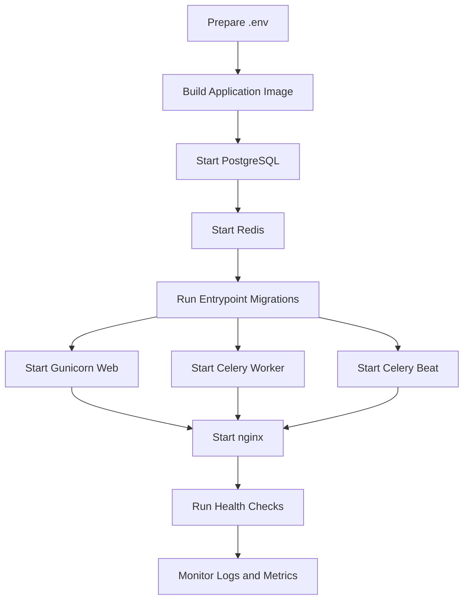

### 22.3 Commands

```powershell
copy .env.example .env
notepad .env
docker compose -f docker-compose.prod.yml up -d --build
docker compose -f docker-compose.prod.yml ps
docker compose -f docker-compose.prod.yml logs -f web worker beat nginx
```

### 22.4 Entrypoint behavior

| Mode | Behavior |
|---|---|
| `web` | Wait for database, run migrations, collect static files, start Gunicorn |
| `worker` | Wait for database, start Celery worker |
| `beat` | Wait for database, start Celery beat |
| `check` | Run checks and exit |

---

## 23. Celery tasks

| Task | Purpose |
|---|---|
| `process_alert_task` | Asynchronous alert processing |
| `enrich_indicators_task` | Enrichment refresh for indicators |
| `taxii_poll_task` | Optional TAXII collection polling |
| `evaluate_detections_task` | Periodic or queued detection evaluation |
| `reassess_assets_task` | Queued asset reassessment |
| `run_scheduled_maintenance` | Hourly maintenance checks and status updates |

If Redis is unavailable, asynchronous endpoints return a clear broker-unavailable response. Synchronous endpoints remain available.

---

## 24. Quality gates

| Gate | Command | Purpose |
|---|---|---|
| Format | `python -m ruff format --check .` | Verify formatting |
| Lint | `python -m ruff check .` | Detect code issues |
| Django check | `python manage.py check` | Detect framework configuration issues |
| Migration drift | `python manage.py makemigrations --check --dry-run --noinput` | Verify no missing migrations |
| Tests | `python manage.py test --noinput` | Run integrated platform suite |
| Static files | `python manage.py collectstatic --noinput` | Verify static collection |
| Production check | `powershell -File scripts\production_check.ps1` | Verify production settings behavior |
| Consolidated | `powershell -File scripts\run_checks.ps1` | Run the local full gate |

### 24.1 Consolidated check script

```powershell
powershell -NoProfile -ExecutionPolicy Bypass -File .\scripts\run_checks.ps1
```

### 24.2 Production check script

```powershell
$env:DJANGO_SECRET_KEY = "replace-with-a-real-secret"
powershell -NoProfile -ExecutionPolicy Bypass -File .\scripts\production_check.ps1
```

The local production check intentionally sets `SECURE_SSL_REDIRECT=False` so it can run without TLS. Real deployments must set it to `True` behind TLS termination.

---

## 25. Test suite

| Test area | Coverage |
|---|---|
| Authentication and RBAC | Registration, login, role permissions |
| Organization scoping | Cross-tenant isolation |
| Alert ingestion | JSON, CSV, normalization, dedupe |
| Classification | Rule and model metadata |
| Intelligence | Indicators, STIX records, MITRE mapping |
| Incidents | Creation, notes, assignment, status, workflow linkage |
| Detections | Rule evaluation, hit review, escalation, backtest |
| Assets | Reassessment, vulnerabilities, CSV export |
| Hunting | Query parsing, execution, saved hunts |
| Risk Fabric | Summary, paths, forecast |
| Copilot | Briefing and question intents |
| Search and status | Unified search and health inventory |
| Audit | Mutation recording and export |

---

## 26. Security controls

| Control | Implementation |
|---|---|
| Authentication | Django session auth for UI and JWT for API |
| Authorization | Role-based permissions with `CanManageSOC` for sensitive views |
| Tenant isolation | Organization-scoped querysets and created records |
| CSRF | Django CSRF middleware for browser mutations |
| Password storage | Django password hashing |
| Secret management | Environment variables and `.env` exclusion from Git |
| SQL injection protection | Django ORM |
| XSS protection | Template escaping and controlled static assets |
| Audit | Mutation and sensitive-operation logging |
| Safety gates | Explicit approval for sensitive workflow actions |
| Static and media | WhiteNoise and nginx-managed paths |
| Production cookies | Secure session and CSRF cookie settings |
| TLS | `SECURE_SSL_REDIRECT` and HSTS in production |

---

## 27. Operations runbook

### 27.1 Daily analyst workflow

| Step | UI path | Action |
|---|---|---|
| 1 | `/system/` | Verify platform health and integration status |
| 2 | `/copilot/` | Read shift briefing |
| 3 | `/alerts/` | Triage new and high-risk alerts |
| 4 | `/detections/` | Review new detection hits |
| 5 | `/incidents/` | Update assigned incidents and notes |
| 6 | `/assets/` | Review highest-risk assets |
| 7 | `/risk-fabric/` | Review attack paths and forecast drivers |
| 8 | `/hunting/` | Run or repeat saved hunts |
| 9 | `/reports/` | Generate required reports |
| 10 | `/audit/` | Confirm sensitive decisions are logged |

### 27.2 Incident commander workflow

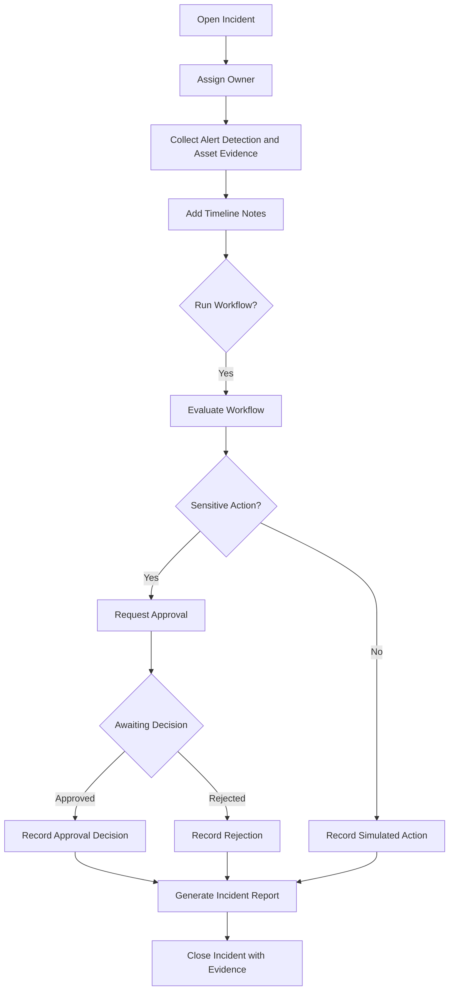

### 27.3 Detection engineer workflow

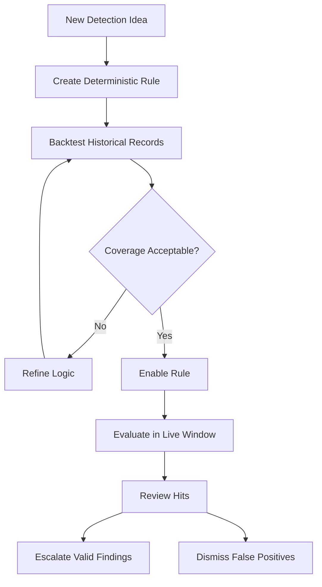

### 27.4 Exposure manager workflow

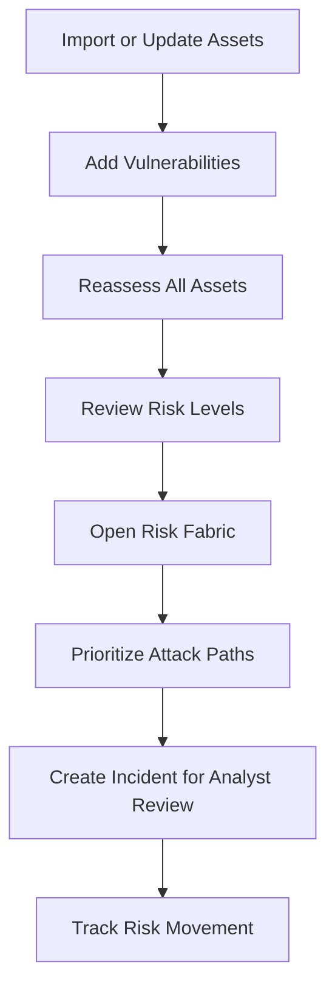

---

## 28. Troubleshooting

| Symptom | Cause | Resolution |
|---|---|---|
| `no such table` | Migrations not applied | Run `python manage.py migrate` |
| Login fails | Seed data not loaded or password changed | Run `seed_autosecops` in demo mode |
| `BROKER_UNAVAILABLE` | Redis or Celery not running | Start Redis or use synchronous endpoints |
| Integration status unavailable | Connector URL or token not configured | Set environment values or accept synthetic status |
| Static files missing | Static files not collected | Run `collectstatic` |
| Production check W008 | HTTPS redirect disabled for local check | Expected locally; enable in real TLS deployment |
| Docker command not found | Docker CLI not installed | Install Docker Desktop or run locally with Python |
| Permission denied on API | User lacks SOC role | Use an analyst or admin account |
| Empty dashboard | Database not seeded | Run all three seed commands |
| Backtest shows zero results | Lookback window has no matching evidence | Ingest sample data or widen lookback |

---

## 29. Extension guide

### 29.1 Add a new detection rule

1. Create a `DetectionRule` through UI, API, admin, or seed command.
2. Choose rule type: `SINGLE_ALERT`, `CORRELATION`, or `THREAT_INTEL`.
3. Define deterministic predicate fields.
4. Backtest before enabling.
5. Enable and evaluate live.
6. Review findings through the detection UI.

### 29.2 Add a new threat hunt token

1. Extend `hunting/query.py` parser.
2. Add the filter to `hunting/services.py`.
3. Add tests in `tests/test_platform.py`.
4. Update the API guide and README token table.

### 29.3 Add a new risk factor

1. Extend `assets/risk.py`.
2. Store the factor in `AssetRiskAssessment.factors`.
3. Update the UI explanation table.
4. Add tests proving deterministic output.
5. Do not introduce autonomous remediation.

### 29.4 Add an external connector

1. Implement a client under `integrations/`.
2. Report configuration and availability through `integrations/status.py`.
3. Add a Celery task only for non-destructive polling.
4. Normalize records into existing models.
5. Never write back to external infrastructure without approval.

---

## 30. Development principles

| Principle | Application |
|---|---|
| Evidence first | Every decision links to database evidence |
| Deterministic defaults | Rules, risk scores, hunts, and copilot answers are reproducible |
| Human approval | Sensitive actions require explicit decision |
| Tenant safety | All records are organization scoped |
| Degrade clearly | Missing integrations report status instead of failing silently |
| Read-only analytics | Advanced analysis does not mutate operational records |
| Testable services | Business logic lives in service modules |
| Deployment parity | Local, Docker, and production settings share one codebase |
| Documentation | Architecture, API, runbook, and READMEs stay current |

---

## 31. Known limitations

| Limitation | Detail |
|---|---|
| Local demo database | SQLite is for demonstration; use PostgreSQL in production |
| External integrations | Require valid configuration and network access |
| Celery features | Require Redis and running workers |
| Copilot | Deterministic decision support, not a generative model |
| Risk forecast | Heuristic projection from current evidence, not a statistical time-series model |
| Backtesting | Replays available records only |
| Docker validation | Requires Docker CLI on the host |

---

## 32. Release readiness checklist

| Item | Status |
|---|---|
| Django application complete | Yes |
| REST API complete | Yes |
| Analyst UI complete | Yes |
| Detection engineering complete | Yes |
| Asset risk complete | Yes |
| Threat hunting complete | Yes |
| Risk Fabric complete | Yes |
| Copilot complete | Yes |
| Backtesting complete | Yes |
| Production settings complete | Yes |
| Docker Compose stack complete | Yes |
| CI workflow complete | Yes |
| Documentation complete | Yes |
| License author included | Yes |
| Tests passing | Yes |
| No automatic infrastructure modification | Yes |

---

## 33. License

MIT License.

Copyright (c) 2026 **n j bala manikantan**.

See `LICENSE` for the full license text.
