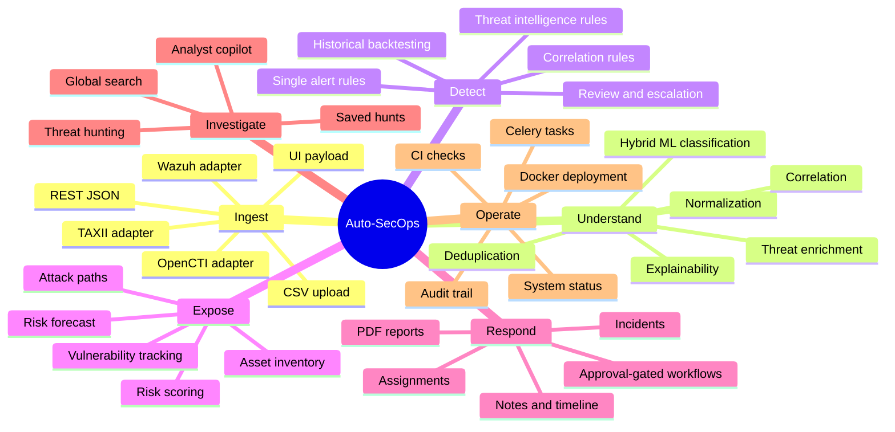
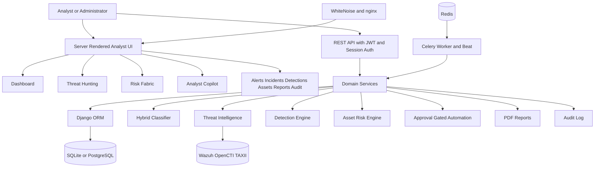
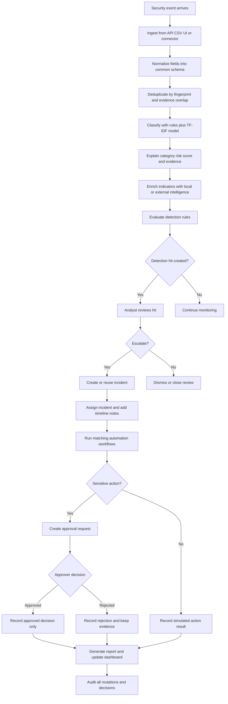
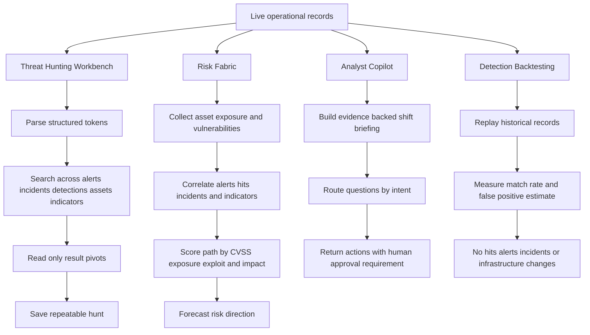
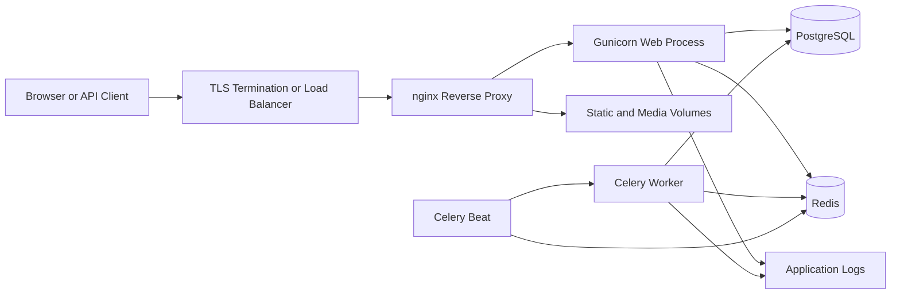

# Auto-SecOps

Auto-SecOps is a production-oriented security operations automation platform. This repository is organized as a deployment container with one primary application folder:

```text
Auto-SecOps/
└── Auto-SecOps/
    ├── Django application source
    ├── REST API and analyst UI
    ├── detection engineering engine
    ├── asset and vulnerability risk fabric
    ├── threat hunting workbench
    ├── deterministic analyst copilot
    ├── Celery worker and beat configuration
    ├── Docker, Gunicorn, and nginx deployment assets
    ├── tests and quality scripts
    └── documentation
```

The nested `Auto-SecOps/` folder is the deployable project root. Run Django and container commands from that folder.

> Copyright and license author: **n j bala manikantan**

---

## Repository purpose

| Area | What this repository provides |
|---|---|
| Security operations | Alert ingestion, normalization, deduplication, correlation, classification, enrichment, incidents, workflows, reports, and audit history |
| Detection engineering | Single-alert, correlation, and threat-intelligence rules with review, escalation, export, and read-only backtesting |
| Exposure management | Asset inventory, vulnerability tracking, deterministic risk scoring, attack paths, and risk forecasting |
| Advanced analysis | Structured threat hunting, saved hunts, analyst copilot briefings, and grounded question answering |
| Deployment | Local Python mode, Docker Compose development mode, and production Compose stack with PostgreSQL, Redis, Gunicorn, Celery, and nginx |
| Safety | Explicit approvals for sensitive workflow actions and no automatic infrastructure modification |
| Quality | Ruff formatting and linting, Django checks, migration drift checks, unit tests, collectstatic, and production-specific checks |

---

## Repository structure

```text
Auto-SecOps/                       Repository root
├── README.md                      Repository overview, maps, diagrams, and deployment guide
├── LICENSE                        MIT License with author name
└── Auto-SecOps/                   Deployable Django project root
    ├── README.md                  Full technical README
    ├── LICENSE                    MIT License with author name
    ├── manage.py                  Django management entry point
    ├── requirements.txt           Pinned Python dependencies
    ├── ruff.toml                  Lint and format configuration
    ├── Dockerfile                 Application container image
    ├── docker-compose.yml         Development stack
    ├── docker-compose.prod.yml    Production-style stack
    ├── gunicorn.conf.py           Production web server configuration
    ├── .env.example               Environment variable template
    ├── .github/workflows/ci.yml   Continuous integration pipeline
    ├── scripts/                   Local and production check scripts
    ├── config/                    Settings, URLs, API router, Celery, system status
    ├── accounts/                  Custom user model, roles, registration, JWT profile
    ├── organizations/             Tenant boundary model and API
    ├── alerts/                    Alert sources, ingestion, normalization, classification hooks
    ├── intelligence/              Indicators, threat records, STIX/TAXII, MITRE mapping
    ├── incidents/                 Incidents, assignments, notes, timelines, workflows
    ├── detections/                Detection rules, hits, review workflow, backtesting
    ├── assets/                    Assets, vulnerabilities, risk scoring, CSV exports
    ├── hunting/                   Structured threat hunts and saved hunt library
    ├── riskfabric/                Attack paths, exposure summary, risk forecast
    ├── copilot/                   Briefings and grounded question answering
    ├── automation/                Workflows, approvals, guarded action engine, seed command
    ├── reports/                   PDF report generation
    ├── audit/                     Audit log model, service, middleware
    ├── dashboard/                 Metrics, charts, dashboard UI
    ├── search/                    Unified global search
    ├── integrations/              Wazuh, OpenCTI, TAXII clients and status reporting
    ├── mlengine/                  Hybrid classifier, SHAP explainability, model info
    ├── templates/                 Server-rendered analyst UI
    ├── static/                    CSS design system
    ├── samples/                   Synthetic JSON and CSV samples
    ├── docs/                      Architecture, API, and operations runbook
    └── tests/                     Integrated platform test suite
```

---

## Capability map



---

## Product architecture



---

## End-to-end SOC workflow



---

## Advanced analysis workflow



---

## Deployment topology



---

## Delivery pipeline

```mermaid
flowchart LR
    Dev[Local Development] --> Format[Ruff Format]
    Format --> Lint[Ruff Check]
    Lint --> Check[Django Check]
    Check --> Migration[Migration Drift Check]
    Migration --> Test[Unit and Integration Tests]
    Test --> Static[Collectstatic]
    Static --> ProdCheck[Production Settings Check]
    ProdCheck --> Build[Docker Build]
    Build --> Deploy[Deploy Stack]
```



---

## Application modules

| Module | Responsibility | Key records or outputs |
|---|---|---|
| `accounts` | Identity and role management | `User`, platform roles, JWT profile |
| `organizations` | Tenant isolation | `Organization` |
| `alerts` | Ingestion and normalization | `AlertSource`, `SecurityAlert`, `AlertClassification` |
| `intelligence` | Indicators and threat records | `ThreatIndicator`, `ThreatIntelligenceRecord` |
| `incidents` | Response lifecycle | `SecurityIncident`, notes, assignments, timeline |
| `detections` | Detection engineering | `DetectionRule`, `DetectionHit`, backtests |
| `assets` | Exposure and vulnerability risk | `Asset`, `Vulnerability`, `AssetRiskAssessment` |
| `hunting` | Structured investigation | `SavedHunt`, hunt results |
| `riskfabric` | Attack path analysis | Paths, forecast, attack surface summary |
| `copilot` | Decision support | Briefings, grounded answers, watchlist |
| `automation` | Workflows and approvals | `AutomationWorkflow`, `WorkflowExecution`, `ApprovalRequest` |
| `reports` | Evidence-based PDF output | `Report` |
| `audit` | Change history | `AuditLog` |
| `dashboard` | Metrics and charts | Live KPI payload |
| `search` | Unified search | Grouped cross-module results |
| `integrations` | External connector status | Wazuh, OpenCTI, TAXII clients |
| `mlengine` | Classification and explainability | Model info, SHAP-enabled explanations |
| `config` | Runtime wiring | Settings, URLs, API router, Celery, system status |

---

## API surface

| Group | Example endpoints | Purpose |
|---|---|---|
| Authentication | `/api/auth/register/`, `/api/auth/token/`, `/api/auth/me/` | Register, obtain JWT, inspect current user |
| Dashboard | `/api/dashboard/metrics/` | Render live SOC KPIs |
| System | `/api/system/status/`, `/health/live/`, `/health/ready/` | Health and runtime metadata |
| Alerts | `/api/alerts/`, `/api/alerts/ingest/`, `/api/alerts/export-csv/` | Ingest and triage alerts |
| Intelligence | `/api/threat-indicators/`, `/api/threat-intelligence/` | Indicators and malicious records |
| Incidents | `/api/incidents/`, `/api/incidents/{id}/note/` | Response lifecycle |
| Detections | `/api/detection-rules/`, `/api/detection-hits/`, backtest actions | Detection engineering |
| Assets | `/api/assets/`, `/api/vulnerabilities/`, `/api/risk-assessments/latest/` | Exposure management |
| Hunting | `/api/hunting/execute/`, `/api/saved-hunts/` | Structured threat hunts |
| Risk Fabric | `/api/risk-fabric/summary/`, `/api/risk-fabric/attack-paths/`, `/api/risk-fabric/forecast/` | Attack paths and forecast |
| Copilot | `/api/copilot/briefing/`, `/api/copilot/ask/` | Evidence-backed decision support |
| Automation | `/api/workflows/`, `/api/approvals/{id}/decide/` | Guarded workflow execution |
| Reports | `/api/reports/`, `/api/reports/generate/` | PDF generation |
| Audit | `/api/audit-logs/`, `/api/audit-logs/export-csv/` | Immutable evidence history |

---

## Quick start

Run from `Auto-SecOps/`:

```powershell
py -3.12 -m venv .venv
.\.venv\Scripts\python.exe -m pip install --upgrade pip
.\.venv\Scripts\python.exe -m pip install -r requirements.txt
.\.venv\Scripts\python.exe manage.py migrate --noinput
.\.venv\Scripts\python.exe manage.py seed_autosecops
.\.venv\Scripts\python.exe manage.py seed_detections
.\.venv\Scripts\python.exe manage.py seed_assets
.\.venv\Scripts\python.exe manage.py runserver
```

Open the UI at `http://127.0.0.1:8000/`.

Default synthetic credentials:

| Field | Value |
|---|---|
| Username | `analyst` |
| Password | `SyntheticPass!123` |

Change the password before any non-demo use.

---

## Production-style deployment

```powershell
Copy-Item .env.example .env
notepad .env
docker compose -f docker-compose.prod.yml up -d --build
docker compose -f docker-compose.prod.yml logs -f
```

Required production values:

| Variable | Description |
|---|---|
| `DJANGO_SECRET_KEY` | Unique high-entropy secret |
| `ALLOWED_HOSTS` | Comma-separated public hostnames |
| `CSRF_TRUSTED_ORIGINS` | Comma-separated trusted origins with scheme |
| `POSTGRES_DB`, `POSTGRES_USER`, `POSTGRES_PASSWORD` | PostgreSQL credentials |
| `SECURE_SSL_REDIRECT` | Enable when TLS is terminated in front of nginx |
| `SYNTHETIC_DATA_ONLY` | Disable for real operational use |
| `CELERY_BROKER_URL` | Redis broker URL |
| `CELERY_RESULT_BACKEND` | Redis result backend URL |

---

## Safety model

Auto-SecOps does not automatically block IPs, disable accounts, isolate hosts, revoke sessions, delete data, or modify production infrastructure. Sensitive actions create approval requests. The bundled automation engine records decisions and simulated results only.

All advanced features are read-only or decision-support:

| Feature | Mutation behavior |
|---|---|
| Threat hunting | Read-only across operational records |
| Saved hunts | Saves query metadata only |
| Risk Fabric | Computes scores from live records |
| Forecast | Deterministic metric calculation |
| Copilot | Generates briefing and recommendations |
| Search | Read-only |
| Detection backtesting | Simulation only; no hits, alerts, incidents, or audit mutations |

---

## Quality checks

```powershell
.\.venv\Scripts\python.exe -m ruff format --check .
.\.venv\Scripts\python.exe -m ruff check .
.\.venv\Scripts\python.exe manage.py check
.\.venv\Scripts\python.exe manage.py makemigrations --check --dry-run --noinput
.\.venv\Scripts\python.exe manage.py test --noinput
.\.venv\Scripts\python.exe manage.py collectstatic --noinput
```

Or:

```powershell
powershell -File scripts\run_checks.ps1
```

Production-specific:

```powershell
$env:DJANGO_SECRET_KEY = "replace-with-a-real-secret"
powershell -File scripts\production_check.ps1
```

---

## License

MIT License. Copyright (c) 2026 **n j bala manikantan**.
